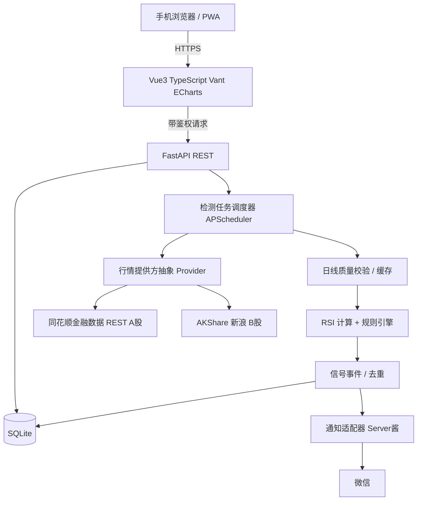
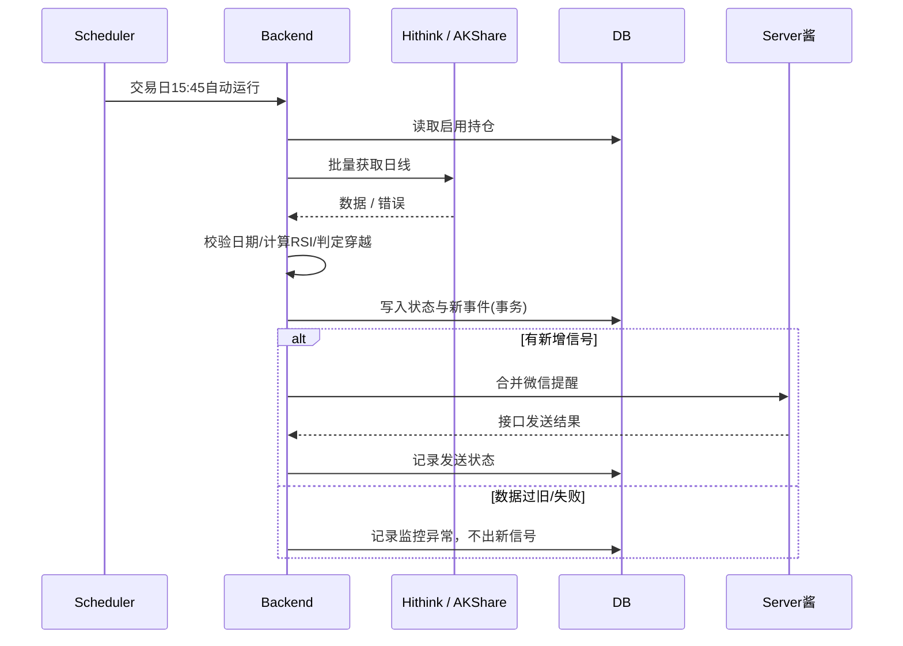

# 02｜系统概要设计（HLD）

> 设计 v0.1 · 面向单用户/少量持仓的手机预警系统

## 1. 架构选择

**采用前后端分离 + 行情适配器 + 纯函数指标计算 + 定时任务 + 通知适配器。** 前端部署 GitHub Pages；常驻 Python 后端部署独立 HTTPS 服务，不能放在 GitHub Pages 静态托管中。



## 2. 技术栈

| 模块 | 推荐 | 说明 |
|---|---|---|
| 手机页面 | Vue 3 + TypeScript + Vite | 单页应用，GitHub Pages 使用正确的 base path |
| 移动组件 | Vant 4 | 表单/卡片/按钮/提示 |
| 数据图表 | Apache ECharts | K 线、RSI、图例 |
| 可安装体验 | vite-plugin-pwa | 主屏幕图标；离线缓存仅缓存 UI，不展示旧行情为实时 |
| 后端 | Python 3.11+ + FastAPI + Pydantic | REST、参数验证 |
| 数据访问 | SQLAlchemy 2 + SQLite | 单机小规模；启用 WAL，迁移用 Alembic |
| 调度 | APScheduler | 交易日检查；单实例任务锁；日志持久化 |
| HTTP 请求 | httpx | 超时、重试、连接复用 |
| A 股 Provider | 同花顺 REST | 服务端 `X-api-key`，历史 K 线批量最多 10 只 |
| B 股 Provider | AKShare（间接数据源） | `stock_zh_b_daily`，稳定性要实测 |
| 计算 | Pandas/NumPy 或纯 Python | 指标和规则必须纯函数、可单测 |
| 消息 | Server酱 Turbo | `SendKey` 存后端，可替换其它通知实现 |
| 部署 | GitHub Pages + 常驻 Python VPS | 先验证数据，后选云端地域与费用 |
| 自动化 | GitHub Actions | 静态前端部署和 CI；不承担需要即时响应的长驻 API |

## 3. 核心模块职责

### 3.1 前端 SPA

- `Dashboard`: 持仓列表、风险数量、异常提示；
- `StockDetail`: K 线/RSI 曲线、触发原因、历史事件；
- `HoldingsEditor`: 股票代码输入、市场识别、添加/停用/删除；
- `Settings`: 风险规则阈值、时间说明、通知状态；
- `Auth`: 登录状态，未登录不可访问私人持仓。

前端不得持有同花顺 Key、Server酱 SendKey；API Base URL 可公开。所有实时数据必须带来源和更新时间。缓存仅用于更快展示，失败时展示旧数据“最后一次成功于…”而非假装本轮成功。

### 3.2 行情 Provider

接口抽象：

```python
class PriceProvider(Protocol):
    def history(self, symbols: list[str], start: date, end: date,
                adjust: str = "forward") -> dict[str, list[DailyBar]]: ...
```

统一 `DailyBar`：

```json
{
  "symbol": "600519.SH",
  "trade_date": "2026-11-19",
  "open": 0.0,
  "high": 0.0,
  "low": 0.0,
  "close": 0.0,
  "volume": 0,
  "currency": "CNY",
  "adjust": "forward",
  "provider": "hithink",
  "fetched_at": "2026-11-20T16:00:00+08:00"
}
```

注意：上面数值全为字段结构示例，不是行情。B 股沪市通常美元计价、深市港币计价，生产实现应按证券市场元数据确认币种，而非沿用 A 股 CNY。指标 RSI 只依赖同一标的同口径收盘价，不进行跨币种比较。

- `HithinkAProvider`: 将代码列表批成每次 ≤10 只；`GET /api/a-share/prices/historical-batch`；请求头 `X-api-key`；转换 `data.item[].item[]` 的 `date_ms`、`close_price` 等字段。外层 `code=0` **不代表每只标的都有数据**。
- `AkshareBProvider`: 900xxx.SH -> `sh900xxx`，200xxx.SZ -> `sz200xxx`；`stock_zh_b_daily(symbol, start_date, end_date, adjust='qfq')`。对空表、字段变动、缺失交易日返回可解释错误。
- provider 失败应提供分类：`AUTH`、`QUOTA`、`TIMEOUT`、`EMPTY`、`UNSUPPORTED_SYMBOL`、`STALE`、`SCHEMA_CHANGED`、`UNKNOWN`。不吞掉异常。

### 3.3 日线质量校验

- 价格 `close > 0`、数值有限；按交易日升序、去重；日期不晚于当前日期；单位/复权方式一致。
- 至少 100 个有效交易日用于 V1 对齐对比；若不足 24 条，RSI24 不可用，所有依赖其值的展示标记 `INSUFFICIENT_DATA`。
- 检测交易日是否有新收盘日线；如未更新，存旧数据但不生成“今天”的新事件。
- `fetched_at`（抓取时间）与 `bar_date`（行情日期）必须分开。

### 3.4 策略引擎

- RSI 值必须可复现，公式/初始化/复权口径独立配置，策略版本号 `rsi-v1.0`。
- 输入某股票经过校验的历史日线，输出 `IndicatorSnapshot` 与 `SignalEvent[]`；无 HTTP、无数据库读写，方便单测和回放。
- RSI 上破 80 与高位死叉为第一阶段正式规则；双重顶/顶背离初版只显示“暂未启用”。
- 不生成目标卖价、仓位指令、未来收益预测。

### 3.5 定时任务与通知

任务管线：

1. 交易日历检查；
2. 防重复执行锁；
3. 获取所有启用持仓并按市场拆分；
4. 查询数据，逐只质量校验；
5. RSI + 规则计算；
6. 事件数据库事务提交（含唯一键）；
7. 汇总当轮首次触发事件；
8. 发送 Server酱（发送结果入库，重试有上限）；
9. 持续记录每只的成功/失败；更新首页健康状态。

策略级唯一键：`(holding_id, trade_date, rule_code, strategy_version)`；通知发送唯一键使用 `event_id + channel` 或合并批次哈希，确保失败重试不会无限刷屏。

注意：**消息送达服务商成功**与**微信端已读**不是一回事，不应写“用户已收到”除非有回执。

## 4. 数据模型（逻辑 ER）

| 表 | 核心字段 | 约束与备注 |
|---|---|---|
| `users` | id, password_hash, created_at | 单用户管理，密码 hash（Argon2），永不明文 |
| `holdings` | id, symbol, display_name, market, enabled, notes, created_at | `symbol` 唯一；默认无成本价 |
| `daily_bars` | symbol, trade_date, open/high/low/close, volume, adjust, provider, fetched_at | 唯一 `(symbol, trade_date, adjust, provider)` |
| `indicator_snapshots` | symbol, bar_date, rsi6/12/24, method, calculated_at | 记公式/版本方便校对 |
| `signal_events` | holding_id, bar_date, rule_code, severity, evidence_json, strategy_version | 唯一事件键，历史不可随意重写 |
| `notification_deliveries` | id, event_ids_json, channel, status, attempts, sent_at, response_code | 不存 SendKey |
| `check_runs` | id, trigger_type, started_at, finished_at, success_count, error_count, state, error_summary | 定时/手动均可追踪 |
| `settings` | key, value_json, updated_at | 配置服务端保存，审计修改 |

SQLite 初期足够，后台单实例部署；将来如需多实例部署，改 PostgreSQL + 分布式任务锁。

## 5. 后端 API 草案（前后端契约）

所有 `/api/v1/*` 除登录与有限健康检查外均需鉴权；响应标准：`{ data, error, meta: { request_id, as_of } }`。

| 方法 | 路径 | 作用 |
|---|---|---|
| POST | `/api/v1/auth/login` | 密码登录，短期访问令牌 |
| GET | `/api/v1/holdings` | 获取持仓、信号状态、数据更新时间 |
| POST | `/api/v1/holdings` | 添加股票（代码+市场+可选名称） |
| PATCH | `/api/v1/holdings/{id}` | 修改备注、启用状态 |
| DELETE | `/api/v1/holdings/{id}` | 删除/停用（建议软删除） |
| GET | `/api/v1/stocks/{symbol}/bars?days=120` | 已缓存的日 K 和指标 |
| GET | `/api/v1/signals?limit=50` | 信号事件与依据 |
| POST | `/api/v1/checks` | 手动发起检测：202 + run_id，防止重复 |
| GET | `/api/v1/checks/{run_id}` | 查看任务状态 |
| GET | `/api/v1/settings` | 读取阈值和通知开关 |
| PUT | `/api/v1/settings` | 保存规则阈值（权限验证） |
| GET | `/api/v1/health` | 非敏感的存活状态 |
| GET | `/api/v1/system/status` | 最近任务/数据源状态（需鉴权） |

需要 `GET /api/v1/stocks/{symbol}/bars` 时注意 URL path `.` 编码兼容问题；也可改用 `?symbol=` 查询。

## 6. 安全策略

- 密钥只存于服务端环境变量：`HITHINK_FINANCE_API_KEY`、`SERVERCHAN_SENDKEY`、数据库相关密钥。
- 前端 GitHub Pages 和 API 在不同 Origin 时，CORS 只允许具体站点域名，不允许 `*` 与认证结合。
- 建议服务端 Argon2 密码哈希；短期访问令牌在前端内存中，避免长期放 localStorage；刷新后重新登录可接受。若用 Cookie，需具体处理跨站 SameSite/CSRF 与 Safari 限制。
- 登录与手动检查端点限流，API 资源有超时/频控，防止外部人恶意消耗 API 额度。
- 不记录含密钥的请求头、URL 或 Server酱 SendKey；输出报告只包含状态和脱敏字段。
- GitHub Pages 是公开静态托管，不能把真实持仓 hardcode 到构建产物。
- HTTPS，数据库定期备份（仅私有保存）。

## 7. 时序与任务运行



## 8. 部署布局

- GitHub：源码、文档、CI、前端 Pages；`/stock-radar/` 需要 Vite `base` 对应子路径。自定义域名时另配 base。
- 常驻云端：Python/FastAPI、APScheduler、SQLite 数据文件、HTTPS 反向代理或平台托管域名。
- 低成本试验：先用本机脚本离线/真实探测；可使用 GitHub Actions 跑**每日无状态批处理**作为过渡，但其计划任务可能延迟，且无法自然提供持久数据库 API 与实时手动刷新。
- 上线前检查用户实际所在地网络的可达性；如果访问 GitHub Pages 不稳定，前端可迁移到其它静态托管，后端逻辑不变。

## 9. 可测试性与迭代边界

- 必须在 CI 中不接真实密钥也能测试 RSI、规则、Provider 响应解析（fixtures）、数据库增删、重复事件抑制。
- 数据源真实集成测试显式 opt-in，禁止在 PR / 公共 CI 中自动消耗第三方额度。
- V1 不要求通知必达，仅要求接口调用状态可验证、异常可追查。
- V2 扩展规则应保留 `strategy_version`，不能覆盖旧信号语义。
